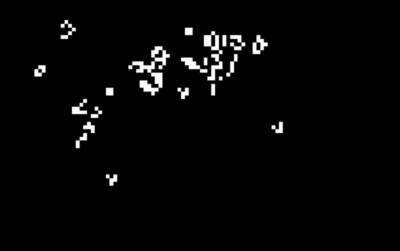

# Game of Life

Conway's Game of Life in Rust, rendered with [macroquad](https://github.com/not-fl3/macroquad).



## Run

```bash
cargo run --release
```

## Controls

- **Left click**: toggle a cell
- **Space**: start/pause the simulation
